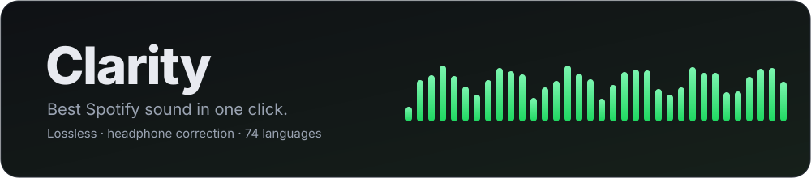
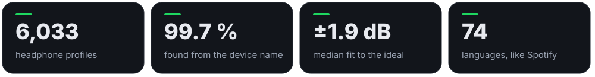
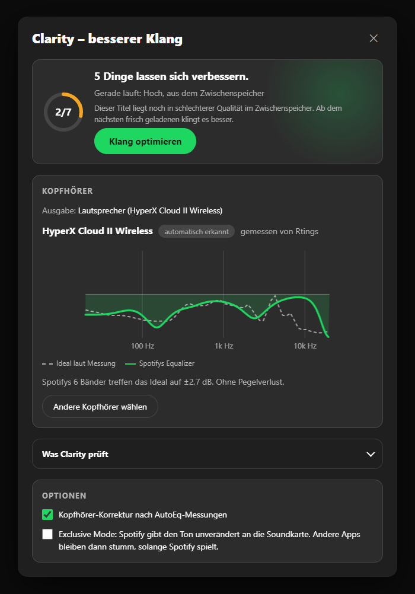
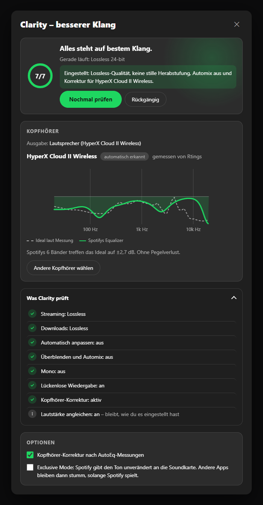
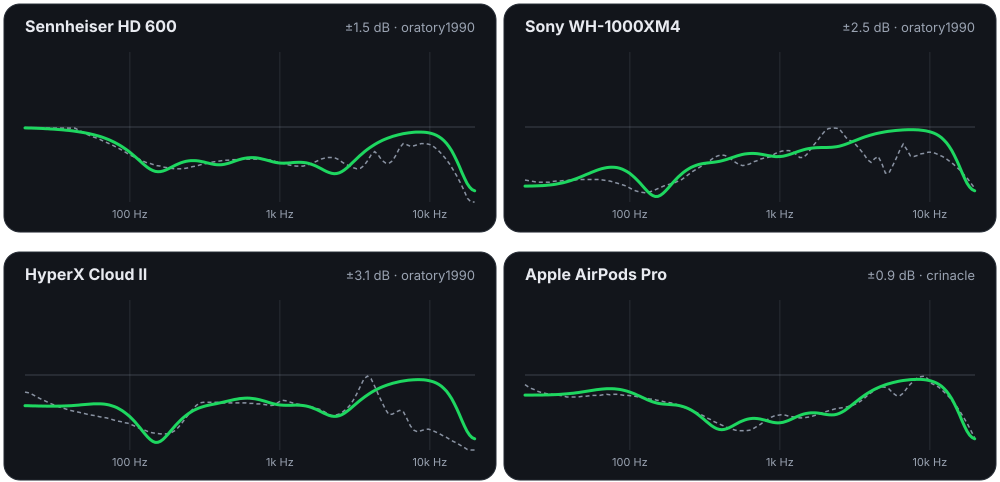

<p align="center"></p>

<p align="center">
  <a href="#installieren"></a>
  
  
  
  <a href="LICENSE"></a>
</p>

<p align="center"><a href="README.md">English</a> · <b>Deutsch</b></p>

Clarity ist eine [Spicetify](https://spicetify.app)-Erweiterung, die mit **einem Klick** den besten Klang aus Spotify holt. Sie stellt Spotifys eigene Klang-Einstellungen richtig ein, sucht eine gemessene Korrektur für deine Kopfhörer und hält alles so. Was du bewusst eingestellt hast, bleibt dabei unangetastet.

<p align="center"></p>

## Was ein Klick macht

| | Was Clarity macht | Warum |
|---|---|---|
| 🎧 | **Kopfhörer-Korrektur.** Erkennt deine Kopfhörer am Windows-Gerätenamen, lädt die passende [AutoEq](https://github.com/jaakkopasanen/AutoEq)-Messung und rechnet sie auf Spotifys eingebauten 6-Band-Equalizer um. | Der größte hörbare Gewinn. Die meisten Kopfhörer liegen mehrere dB neben einem neutralen Klang. |
| 💎 | **Beste Quelle.** Lossless mit Premium, sonst „Sehr hoch“ (320 kbit/s), für Streaming und Downloads. Jeder Wert wird zurückgelesen. | Spotify steht oft auf „Automatisch“. |
| 📶 | **Keine stille Herabstufung.** Schaltet „Automatisch anpassen“ aus. | Sonst senkt Spotify bei schwachem Netz heimlich die Qualität. |
| 🔗 | **Sauberer Ablauf.** Überblenden, Automix und Mono aus, lückenlose Wiedergabe an. | Titel klingen so, wie sie gemastert wurden. |
| 🔊 | **Lässt „Lautstärke angleichen“ in Ruhe.** Clarity liest es nur aus, damit die Korrektur den Spielraum nutzen kann, den Spotify lässt. | Gute Funktion: Kein Titel ist plötzlich zu laut oder zu leise. |
| 🎚️ | **Exclusive Mode (optional).** Spotify gibt den Ton unverändert an die Soundkarte, am Windows-Mixer vorbei. | Bit-genaue Ausgabe. Standardmäßig aus, weil andere Apps dann stumm sind. |

Clarity merkt sich, dass du es eingeschaltet hast. Bei jedem Start und bei jedem Wechsel des Ausgabegeräts prüft es erneut. **Rückgängig** stellt alles wieder her, was es geändert hat.

## So sieht es aus

<table>
  <tr>
    <td width="50%"></td>
    <td width="50%"></td>
  </tr>
  <tr>
    <td align="center"><sub>Vorher – Clarity zeigt, was besser geht</sub></td>
    <td align="center"><sub>Nach einem Klick – mit Korrekturkurve</sub></td>
  </tr>
</table>

Das Fenster spricht deine Spotify-Sprache (alle 74), ist sanft animiert und beachtet „Bewegung reduzieren“. Es zeigt, was gerade wirklich läuft, zum Beispiel „Lossless 24-bit“ oder „aus dem Zwischenspeicher“.

## Wie gut ist die Korrektur?

Spotifys Equalizer hat sechs feste Bänder: 60, 150, 400, 1.000 und 2.400 Hz sowie 15 kHz. Clarity passt sie per Kleinste-Quadrate-Verfahren an die AutoEq-Kurve an und sorgt dafür, dass nichts übersteuert. Gestrichelt ist die ideale Korrektur laut Messung, grün das, was Spotifys Equalizer daraus macht:

<p align="center"></p>

Gemessen an einer festen Stichprobe von 80 echten AutoEq-Profilen:

- Ohne Korrektur liegen Kopfhörer im Median **±6,3 dB** neben dem Ziel.
- Mit Clarity sind es **±1,9 dB**, also mehr als dreimal näher.
- Der Pegelverlust liegt im Median bei **0 dB**. Clarity senkt die Lautstärke nur, wenn eine Anhebung übersteuern würde. Steht „Lautstärke angleichen“ auf Leise oder Normal, erlaubt es 1,5 dB Anhebung statt 0,5 dB, weil Spotify dort Platz lässt.

## Wie die Erkennung funktioniert

Windows nennt Ausgänge etwa `Kopfhörer (2- WH-1000XM4)` oder bei USB-Headsets `Lautsprecher (HyperX Cloud II Wireless)`. Clarity liest das Modell aus diesem Namen:

- **Sicherer Treffer** → wird von selbst gesetzt. Jedes Modellwort muss vorkommen, und eine genannte Marke schließt andere Marken aus. Zusammengeschriebene Namen (`WH1000XM4`) und römische Zahlen (`Cloud 2` = `Cloud II`) zählen mit.
- **Unsicher** → Clarity schlägt die nächsten Modelle vor, und du wählst. Es rät nie selbst.
- **Unbekannt oder Lautsprecher** → du suchst deine Kopfhörer einmal heraus oder wählst „Keine Korrektur“. Die Wahl gilt für dieses Ausgabegerät.

Geprüft an allen 6.033 AutoEq-Namen: Mit Marke im Gerätenamen werden **99,7 %** erkannt, ohne Marke **77 %**. Nur **0,2 %** landen bei einem anderen Modell, und das sind fast immer Schreibvarianten wie `Liric II` / `Liric 2`.

## Installieren

**Marketplace:** Im Spicetify Marketplace nach **Clarity** suchen und installieren.

**Von Hand** (Windows PowerShell):

```powershell
Invoke-WebRequest https://raw.githubusercontent.com/Passimoritz/spicetify-clarity/main/dist/clarity.js -OutFile "$env:APPDATA\spicetify\Extensions\clarity.js"
spicetify config extensions clarity.js
spicetify apply
```

**macOS / Linux:**

```bash
curl -fsSL https://raw.githubusercontent.com/Passimoritz/spicetify-clarity/main/dist/clarity.js -o "$(dirname "$(spicetify -c)")/Extensions/clarity.js"
spicetify config extensions clarity.js
spicetify apply
```

Danach unten rechts neben der Lautstärke aufs Balken-Symbol klicken.

## Gut zu wissen

- **Den Audiostrom selbst kann Clarity nicht verändern.** Das kann keine Erweiterung, weil Spotify nativ und DRM-geschützt abspielt. Clarity stellt Spotifys eigene Einstellungen ein, und nur die kommen wirklich bei deinen Ohren an.
- **Interne Schnittstellen.** `SettingsAPI`, `EqualizerAPI` und `ExclusiveModeAPI` sind Spotify-intern (gebaut für Spotify 1.3.6). Clarity prüft jede vor der Benutzung und überspringt, was fehlt.
- **Zwischen 2,4 und 15 kHz hat der Equalizer kein Band.** Dort sitzt der größte Teil der Restabweichung. Das Fenster zeigt den genauen Wert für deine Kopfhörer.
- **Bluetooth** komprimiert selbst, Lossless bringt dort wenig. Den Exclusive Mode schaltet Clarity bei Bluetooth nie ein.
- **Datenschutz:** Die einzigen Netzwerkzugriffe gehen an die öffentlichen AutoEq-Dateien auf GitHub. Kein Konto, kein Server, kein Tracking.

## Sprachen

Alle 74 Spotify-Sprachen. Für Einstellungen und Qualitätsstufen nutzt Clarity in jeder Sprache Spotifys eigene Begriffe:

`af am ar ar-EG ar-MA ar-SA az bg bho bn bs ca cs da de el en en-GB es es-419 es-AR es-MX et eu fa fi fil fr fr-CA gl gu he hi hr hu id is it ja kn ko lt lv mk ml mr ms nb ne nl or pa-IN pa-PK pl pt-BR pt-PT ro ru sk sl sr sv sw ta te th tr uk ur vi zh-CN zh-HK zh-TW zu`

Klingt ein Text komisch? `locales/<code>.json` bearbeiten und einen Pull Request öffnen. `node tools/build.js` prüft jeden Schlüssel und jeden `{Platzhalter}`.

## Entwickeln

```bash
node tools/build.js      # src/ + locales/ → dist/clarity.js (bricht bei fehlenden Schlüsseln oder Platzhaltern ab)
node test/fit.test.js    # Filtermathematik, Anpassung und Geräteerkennung
node tools/docs.js       # misst gegen die aktuelle AutoEq-Datenbank, zeichnet docs/*.svg neu
```

## Danke

Kopfhörer-Messungen: [AutoEq](https://github.com/jaakkopasanen/AutoEq) von Jaakko Pasanen, mit Daten von oratory1990, crinacle, Rtings und anderen. Filtermathematik: Robert Bristow-Johnsons *Audio EQ Cookbook*.

MIT-Lizenz · keine Verbindung zu Spotify
