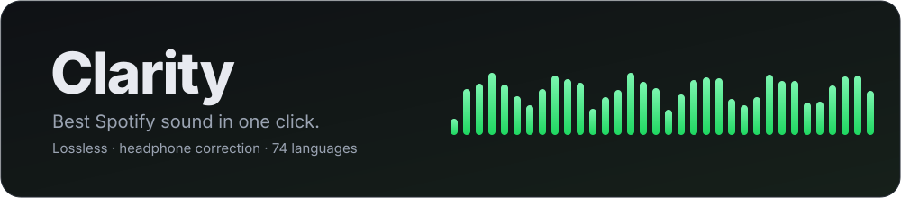
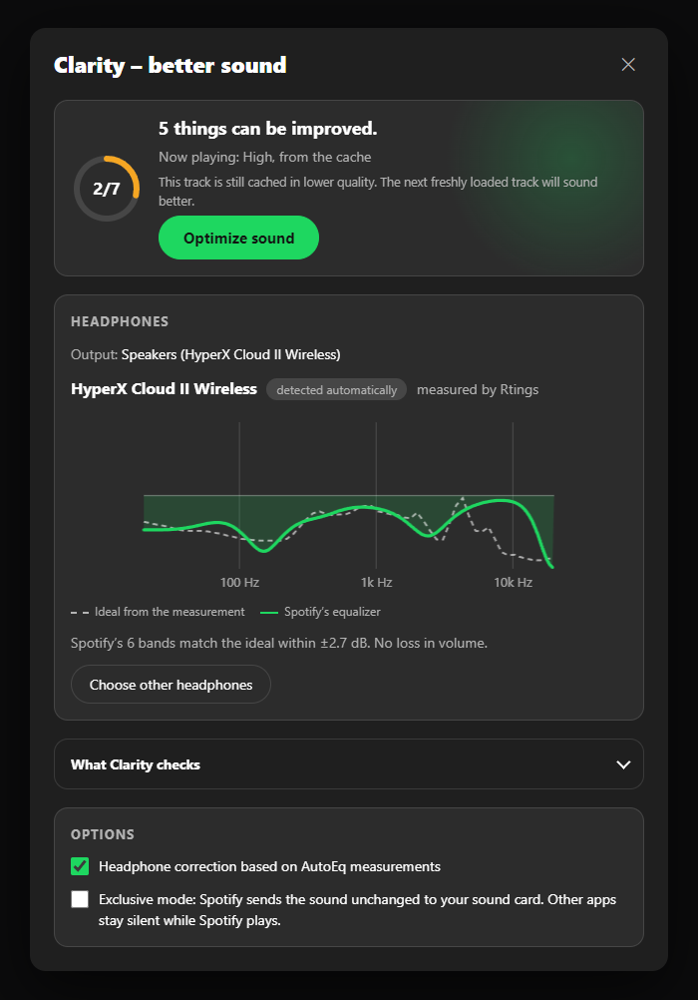
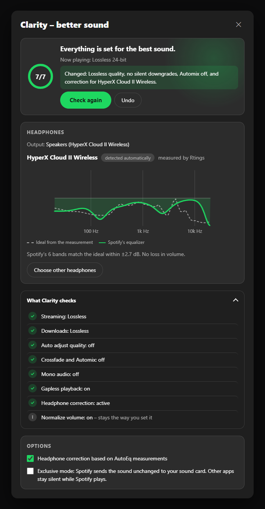
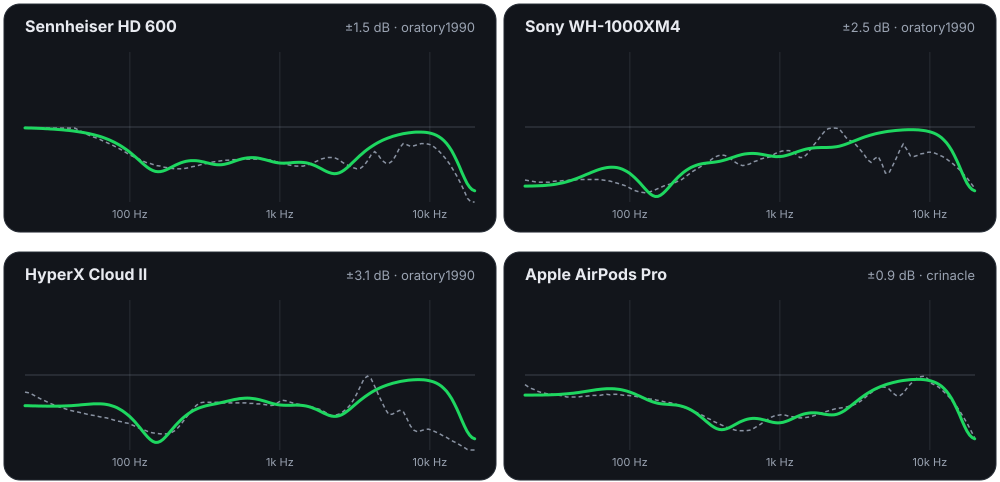

<p align="center"></p>

<p align="center">
  <a href="#install"></a>
  
  
  
  <a href="LICENSE"></a>
</p>

<p align="center"><b>English</b> · <a href="README.de.md">Deutsch</a></p>

Clarity is a [Spicetify](https://spicetify.app) extension that gets the best sound out of Spotify with **one click**. It sets Spotify's own sound settings correctly, finds a measured correction for your headphones and keeps everything that way – without touching anything you chose on purpose.

<p align="center"></p>

## What one click does

| | What Clarity does | Why |
|---|---|---|
| 🎧 | **Headphone correction.** Recognizes your headphones from the Windows device name, loads the matching [AutoEq](https://github.com/jaakkopasanen/AutoEq) measurement and fits it onto Spotify's built-in 6-band equalizer. | The biggest audible gain. Most headphones are several dB off a neutral sound. |
| 💎 | **Best source.** Lossless with Premium, otherwise Very high (320 kbps), for streaming and downloads. Every value is read back. | Spotify often defaults to *Automatic*. |
| 📶 | **No silent downgrades.** Turns *Auto adjust quality* off. | Otherwise Spotify quietly drops the quality on a weak connection. |
| 🔗 | **Clean playback.** Crossfade, Automix and mono off, gapless on. | Tracks play the way they were mastered. |
| 🔊 | **Leaves *Normalize volume* alone.** Clarity only reads it, so the correction can use the headroom Spotify leaves. | It's a good feature: no more tracks that are suddenly too loud or too quiet. |
| 🎚️ | **Exclusive mode (optional).** Spotify sends the sound unchanged to your sound card, bypassing the Windows mixer. | Bit-perfect output. Off by default because other apps go silent. |

Clarity remembers that you turned it on. It checks again on every start and whenever you switch the output device. **Undo** restores everything it changed.

## See it

<table>
  <tr>
    <td width="50%"></td>
    <td width="50%"></td>
  </tr>
  <tr>
    <td align="center"><sub>Before – Clarity shows what can be better</sub></td>
    <td align="center"><sub>After one click – with the correction curve</sub></td>
  </tr>
</table>

The panel speaks your Spotify language (all 74), animates gently and respects *reduce motion*. It shows what is playing right now, for example "Lossless 24-bit" or "from the cache".

## How good is the correction?

Spotify's equalizer has six fixed bands (60, 150, 400, 1,000, 2,400 Hz and 15 kHz). Clarity fits them to the AutoEq curve with a least-squares solver and keeps the result from clipping. The dashed line is the ideal correction from the measurement, the green line is what Spotify's equalizer actually does:

<p align="center"></p>

Measured on a fixed sample of 80 real AutoEq profiles:

- Without correction, headphones are a median **±6.3 dB** away from the target.
- With Clarity it's **±1.9 dB**, more than three times closer.
- The median volume loss is **0 dB**. Clarity only lowers the level when a boost would clip. With *Normalize volume* on Quiet or Normal it allows 1.5 dB of boost instead of 0.5 dB, because Spotify leaves room there.

## How detection works

Windows names outputs like `Headphones (2- WH-1000XM4)` or, for USB headsets, `Speakers (HyperX Cloud II Wireless)`. Clarity reads the model from that name:

- **Sure match** → applied automatically. Every model word must be there. A named brand rules out other brands. Merged spellings (`WH1000XM4`) and Roman numerals (`Cloud 2` = `Cloud II`) count.
- **Not sure** → Clarity suggests the closest models and lets you pick. It never guesses on its own.
- **Unknown or speakers** → search your headphones once, or choose *No correction*. The choice is stored per output device.

Tested against all 6,033 AutoEq names: **99.7 %** are found when the device name contains the brand, **77 %** without the brand. Only **0.2 %** land on a different model, and those are mostly spelling twins like `Liric II` / `Liric 2`.

## Install

**Marketplace:** open the Spicetify Marketplace, search for **Clarity** and install it.

**Manually** (Windows PowerShell):

```powershell
Invoke-WebRequest https://raw.githubusercontent.com/Passimoritz/spicetify-clarity/main/dist/clarity.js -OutFile "$env:APPDATA\spicetify\Extensions\clarity.js"
spicetify config extensions clarity.js
spicetify apply
```

**macOS / Linux:**

```bash
curl -fsSL https://raw.githubusercontent.com/Passimoritz/spicetify-clarity/main/dist/clarity.js -o "$(dirname "$(spicetify -c)")/Extensions/clarity.js"
spicetify config extensions clarity.js
spicetify apply
```

Then click the bars icon at the bottom right, next to the volume controls.

## Good to know

- **Clarity can't change the audio stream itself.** No extension can: Spotify plays natively and DRM-protected. Clarity sets Spotify's own settings, which is the only thing that really reaches your ears.
- **Internal APIs.** `SettingsAPI`, `EqualizerAPI` and `ExclusiveModeAPI` are Spotify internals (built against Spotify 1.3.6). Clarity checks each one before use and skips what's missing.
- **The equalizer has no band between 2.4 and 15 kHz.** That's where most of the remaining deviation sits. The panel shows the exact figure for your headphones.
- **Bluetooth** compresses on its own, so Lossless helps little there. Clarity never turns on exclusive mode for Bluetooth.
- **Privacy:** the only network requests go to the public AutoEq files on GitHub. No account, no server, no tracking.

## Languages

All 74 Spotify UI languages. Clarity uses Spotify's own words for settings and quality levels in each language:

`af am ar ar-EG ar-MA ar-SA az bg bho bn bs ca cs da de el en en-GB es es-419 es-AR es-MX et eu fa fi fil fr fr-CA gl gu he hi hr hu id is it ja kn ko lt lv mk ml mr ms nb ne nl or pa-IN pa-PK pl pt-BR pt-PT ro ru sk sl sr sv sw ta te th tr uk ur vi zh-CN zh-HK zh-TW zu`

A text sounds off? Edit `locales/<code>.json` and open a pull request. `node tools/build.js` checks every key and `{placeholder}`.

## Development

```bash
node tools/build.js      # src/ + locales/ → dist/clarity.js (fails on missing keys or placeholders)
node test/fit.test.js    # filter math, fitting and device detection
node tools/docs.js       # measures against the live AutoEq database, redraws docs/*.svg
```

## Thanks

Headphone measurements: [AutoEq](https://github.com/jaakkopasanen/AutoEq) by Jaakko Pasanen, with data from oratory1990, crinacle, Rtings and others. Filter math: Robert Bristow-Johnson's *Audio EQ Cookbook*.

MIT License · not affiliated with Spotify
